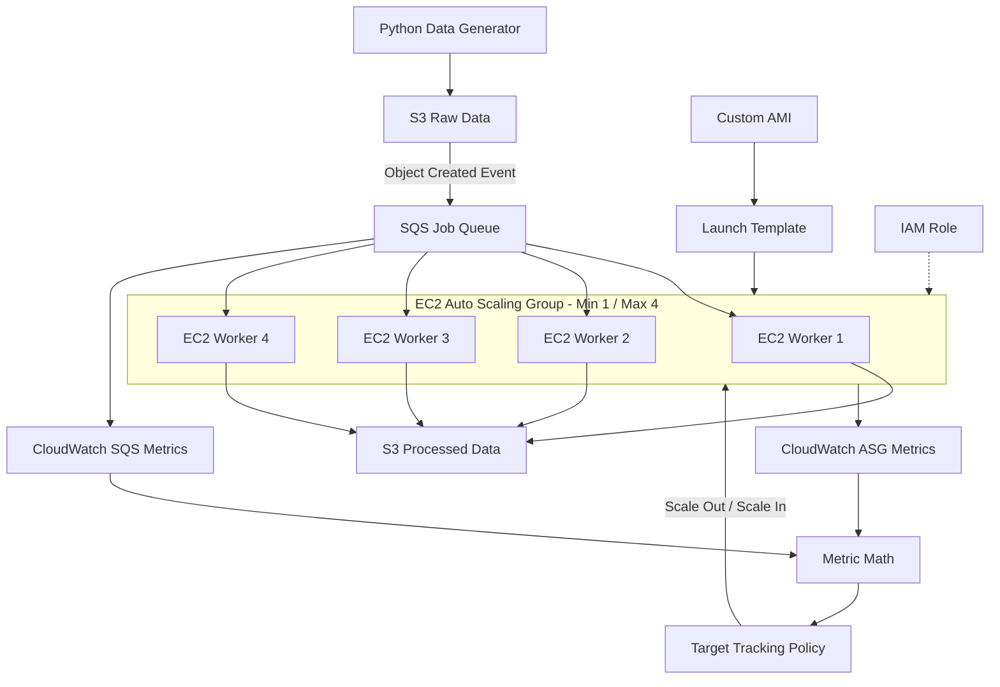
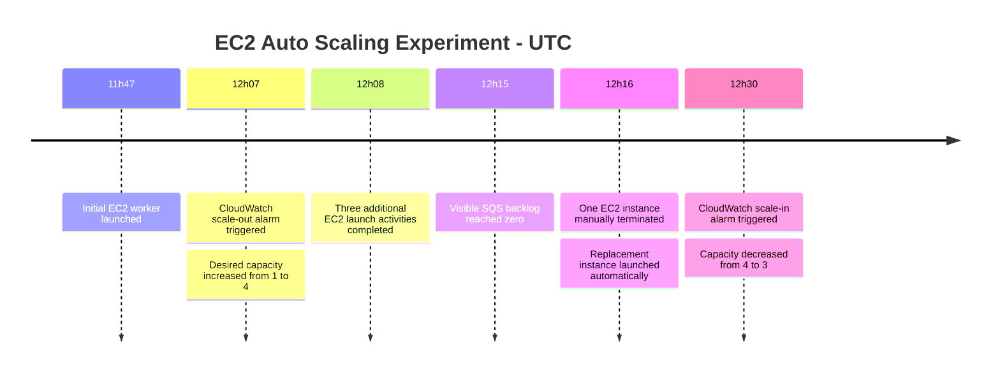

# Elastic EC2 Data Processing Fleet

An event-driven, elastic data processing architecture on AWS that automatically scales EC2 workers based on SQS queue backlog.

## Project Overview

This project demonstrates how to build a scalable and self-healing data processing infrastructure using Amazon EC2 and EC2 Auto Scaling.

Synthetic e-commerce transaction batches are uploaded to Amazon S3, triggering SQS notifications. EC2 workers consume these messages, process transaction data, and write enriched datasets back to S3.

The infrastructure automatically adjusts its computing capacity according to workload demand.

## Architecture



## Technologies

- Amazon EC2
- EC2 Auto Scaling Groups
- EC2 Launch Templates
- Custom Amazon Machine Images
- Amazon EBS
- Amazon S3
- Amazon SQS
- Amazon CloudWatch
- CloudWatch Metric Math
- AWS IAM
- AWS Systems Manager Session Manager
- AWS CLI
- Python
- Boto3
- Linux systemd
- GitHub Codespaces

## Data Processing Workflow

1. Generate synthetic e-commerce transaction batches using Python.
2. Upload JSON files to the S3 raw data prefix.
3. Trigger S3 event notifications.
4. Deliver processing jobs to an SQS Standard Queue.
5. Consume jobs using EC2 workers.
6. Download and transform transaction records.
7. Calculate the total transaction amount.
8. Write enriched JSON files to the S3 processed data prefix.
9. Delete successfully processed SQS messages.

The transformation calculates:

`total_amount = quantity × unit_price`

## EC2 Infrastructure

| Configuration | Value |
|---|---|
| AWS Region | eu-central-1 |
| Operating System | Amazon Linux 2023 |
| Instance Type | t3.micro |
| Architecture | x86-64 |
| vCPU | 2 |
| Memory | 1 GiB |
| Root Storage | 10 GiB gp3 |
| EBS Encryption | Enabled |
| CPU Credit Mode | Standard |
| Remote Access | SSM Session Manager |
| Inbound Security Rules | None |
| Authentication | IAM Instance Profile |
| Metadata Service | IMDSv2 |

## Custom AMI and Launch Template

A custom AMI was created from a configured EC2 worker containing:

- Python runtime
- Python virtual environment
- Boto3 dependencies
- Data processing application
- Enabled systemd worker service

The AMI was referenced by an EC2 Launch Template, allowing the Auto Scaling Group to provision preconfigured workers without manually installing the application on each instance.

## Auto Scaling Strategy

The Auto Scaling Group uses a target tracking scaling policy based on SQS backlog per instance.

```text
Backlog per instance =
    ApproximateNumberOfMessagesVisible
    /
    GroupInServiceInstances
```

| Parameter | Value |
|---|---|
| Minimum Capacity | 1 |
| Initial Desired Capacity | 1 |
| Maximum Capacity | 4 |
| Target Backlog per Instance | 10 |
| Instance Warmup | 60 seconds |
| Scale-in | Enabled |
| Health Check | EC2 |
| Availability Zone Configuration | Multi-AZ |

CloudWatch Metric Math combines SQS and Auto Scaling metrics into a workload-based scaling metric.

## Experimental Results

Experiments were performed on November 25, 2026.

| Experiment | Observed Result |
|---|---|
| Initial Data Processing | 10 output JSON files |
| Automatic Worker Startup | systemd service active |
| Load Test | 200 input JSON files |
| Records per Generated Batch | 1,000 |
| Peak Visible SQS Backlog | 186 messages |
| Automatic Scale-out | 1 → 4 instances |
| Scale-out Launch Activity | 65 seconds |
| Self-Healing | Terminated instance automatically replaced |
| Replacement Launch Activity | 5 seconds |
| Automatic Scale-in | 4 → 3 instances |
| Scale-in Termination Activity | 42 seconds |
| Load Test Output | 200 processed JSON files |
| Observed Visible Queue Backlog | 0 messages |

The load test was configured to generate 200,000 synthetic transaction records. All 200 expected output files were observed in S3.

### Scaling Timeline



## Repository Structure

```text
aws-ec2-elastic-data-processing-fleet/
├── infrastructure/
│   ├── data-fleet-worker.service
│   ├── iam-policy.json
│   ├── sqs-resource-policy.json
│   └── target-tracking-policy.json
├── src/
│   ├── generate_data.py
│   └── worker.py
├── .gitignore
├── LICENSE
├── requirements.txt
└── README.md
```

## Reproducing the Project

### Generate Synthetic Data

```bash
python src/generate_data.py \
  --batches 200 \
  --records 1000 \
  --output data/scale-test
```

### Provision AWS Resources

1. Create an S3 bucket and an SQS Standard Queue.
2. Configure the SQS resource policy.
3. Configure S3 object creation notifications for the `raw/` prefix and `.json` suffix.
4. Create an EC2 IAM role with the project IAM policy and Systems Manager permissions.
5. Launch an Amazon Linux 2023 EC2 instance.
6. Install Python, pip and Git.
7. Clone the repository and install its Python dependencies in a virtual environment.
8. Configure and enable the systemd worker service.
9. Create a custom AMI.
10. Create a Launch Template referencing the AMI.
11. Create an Auto Scaling Group and enable group metrics collection.
12. Configure the target tracking scaling policy.
13. Upload generated batches to S3 and observe processing and scaling behavior.

Infrastructure configuration files contain placeholders that must be replaced with deployment-specific values.

## Security

- No inbound SSH access.
- Remote administration through AWS Systems Manager.
- IAM role-based authentication instead of hardcoded AWS credentials.
- Resource-scoped S3 and SQS permissions.
- S3 public access blocked.
- Encrypted EBS storage.
- IMDSv2 configuration.
- SQS server-side encryption.

## Limitations and Production Considerations

This project is a learning-oriented infrastructure demonstration rather than a production-ready platform.

- The processing delay is intentionally introduced to simulate sustained workload.
- SQS Standard Queues provide at-least-once delivery, so duplicate processing is possible.
- Deterministic output paths allow repeated processing of immutable input files to overwrite the same output object.
- Dead-letter queue handling is not implemented.
- Dynamic visibility timeout extension is not implemented.
- Graceful worker shutdown during scale-in is not implemented.
- Infrastructure provisioning is performed manually rather than through Infrastructure as Code.
- Multi-AZ instance distribution was not independently verified.
- Scale-in to minimum capacity was not observed before cleanup.
- Output file counts were verified, but record-level completeness and correctness were not independently validated.
- EC2 launch activity durations do not represent application readiness times.
- The Python 3.9 runtime used during the experiment generated a Boto3 support warning.

## Resource Cleanup

Project resources were removed after the experiments using AWS CLI through AWS CloudShell.

Cleanup covered EC2 Auto Scaling, EC2 instances, Launch Templates, the custom AMI, associated snapshots, S3, SQS, security groups, IAM resources and remaining project alarms.

A subsequent EBS volume query returned no volumes in the project region.

## Learning Outcomes

- EC2 instance provisioning and lifecycle management
- Custom AMI creation
- EBS-backed instance images
- Launch Template configuration
- Workload-driven horizontal scaling
- CloudWatch Metric Math
- Target tracking scaling policies
- EC2 self-healing infrastructure
- Event-driven data processing
- IAM-based service authentication
- Automated Linux application startup
- AWS resource lifecycle and cost management

## License

MIT License.
